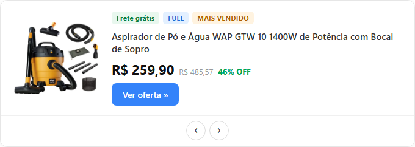
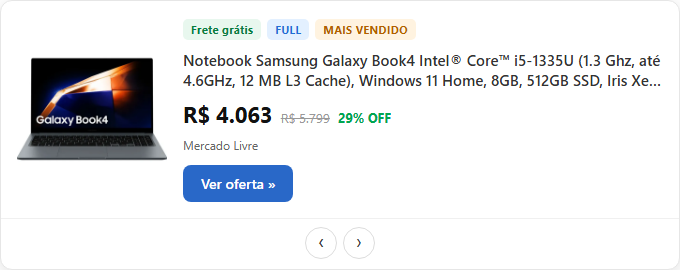
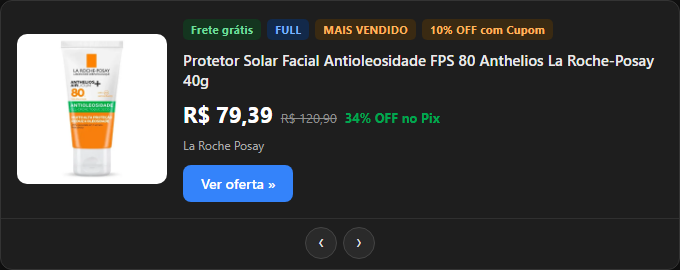
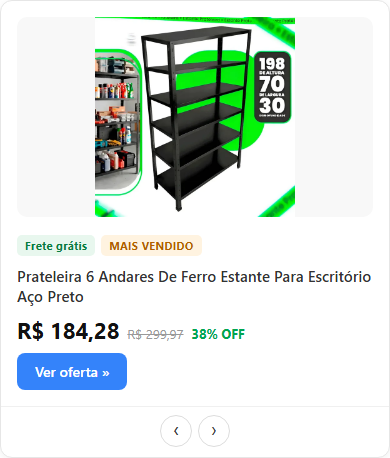
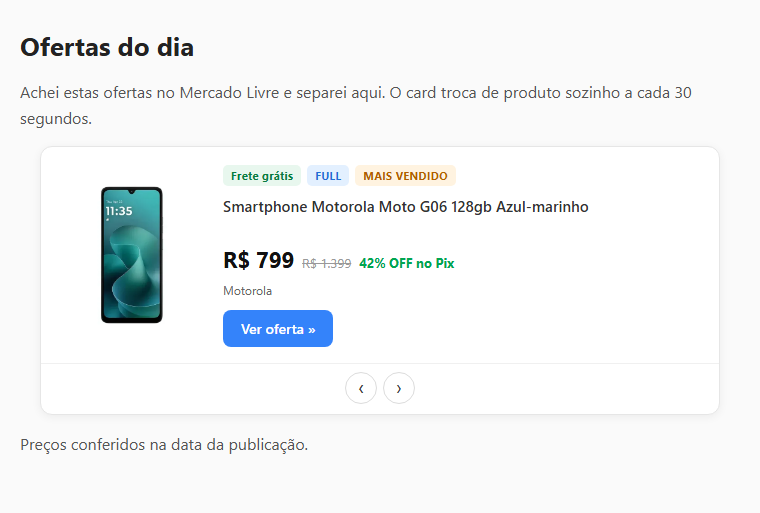

# Projeto Becker — vitrine de afiliado do Mercado Livre para o Blogger


Um card de produto que troca sozinho a cada 30 segundos, feito para colar em um post ou
na barra lateral do Blogger (HTML/JavaScript) — sem plugin, sem servidor, sem banco.
O visitante vê uma oferta, clica e cai no anúncio **com o seu link de afiliado**.

O problema real que ele resolve: manter uma vitrine de afiliado atualizada é chato.
Você tem uma lista de links curtos, os preços mudam toda semana e atualizar à mão é
erro na certa. Aqui a lista é a fonte; o widget é gerado a partir dela.

## Classificação

- **Propósito** — transformar uma lista de links de afiliado em um widget pronto para o
  Blogger, com título, imagem, preço, preço anterior, desconto, loja e selos reais.
- **Maturidade** — MVP funcional: 53 produtos extraídos, widget validado em navegador
  real (imagem carrega, card troca, nenhum erro de console) e **publicado no site da
  [FS Imobiliária](https://www.fsimobiliaria.com/)**.
- **O que está sendo treinado** — automação de navegador com Playwright, leitura de
  página que só existe depois do JavaScript rodar, e geração de artefato reprodutível.
- **Quem usaria** — afiliado ou blogueiro que quer vitrine rotativa sem instalar plugin
  e sem depender de API paga.

## O que tem aqui

| Arquivo | Para que serve |
|---|---|
| `bloggermercadolivre.js` | O widget final (HTML + CSS + JS em um arquivo). É isto que vai para o Blogger. |
| `listalinks.txt` | A fonte da verdade: os links curtos de afiliado (`meli.la/...`). **Local, fora do git** — crie o seu. |
| `scripts/extrair_destaques.js` | Abre cada link no Chromium e lê o anúncio em destaque. |
| `scripts/gerar_widget.js` | Reescreve a lista `DADOS` do widget a partir do JSON extraído. |
| `scripts/testar_widget.js` | Abre o widget, confere imagem, preço e troca de produto. |
| `scripts/capturar_telas.js` | Gera as imagens de `docs/img/`. |
| `data/` · `docs/` · `notebooks/` | Dados (fora do git), documentação e análises. |

## Como rodar

Requisitos: **Node 24+** e **Git**. O Python do projeto não é usado por este pipeline.

Antes de extrair, crie o `listalinks.txt` na raiz do projeto com um link de afiliado por
linha (ele é local e não está versionado — cada pessoa usa os seus):

```text
https://meli.la/SEU_LINK_1
https://meli.la/SEU_LINK_2
```

```powershell
npm install                      # instala o Playwright
npx playwright install chromium  # baixa o navegador usado na extração
```

Atualizar a vitrine inteira (extrair → gerar → testar):

```powershell
npm run atualizar
```

Ou passo a passo, quando quiser controlar cada etapa:

```powershell
npm run extrair   # lê listalinks.txt e grava data/processed/produtos.json
npm run gerar     # reescreve o DADOS dentro de bloggermercadolivre.js
npm run testar    # abre o widget e valida o card
npm run capturar  # atualiza as capturas de docs/img/
```

### Instalar no Blogger

1. Blogger → **Páginas** → Nova página (ou **Layout** → Adicionar gadget → HTML/JavaScript).
2. No editor, clique em **Exibir HTML** e cole **todo** o conteúdo de `bloggermercadolivre.js`.
3. Publique (ou salve o gadget). O widget funciona repetido em mais de um lugar.

## Capturas



*O card no estado normal: imagem, selos, título, preço atual, preço riscado e o desconto.*



*Clicar em `›` (ou esperar 30 segundos) troca o produto — aqui, um produto com desconto em Pix.*



*O modo noite é detectado sozinho: acompanha o tema do aparelho e a classe de tema do blog.*



*Em tela estreita o layout se reorganiza em coluna, sem cortar preço nem botão.*



*No contexto real: um post de "Ofertas do dia" com o card entre os parágrafos.*

## Limitações conhecidas

- **Sem nota de avaliação.** O card da vitrine não traz estrelas nem quantidade de
  avaliações; o campo vai nulo e o widget esconde essa parte. Hoje a cobertura é de loja
  em 44/53 produtos e frete grátis em 47/53.
- **Um produto por link.** Cada link curto abre a vitrine com um item em destaque — é
  esse item que entra no card; as recomendações ao redor dele ficam de fora.
- **Preço é foto do momento.** Rode `npm run atualizar` antes de publicar; o valor
  gravado é o do instante da extração.
- **Depende do HTML do Mercado Livre.** A extração usa as classes `poly-card` e
  `poly-component__*`; se o site mudar o layout, os seletores precisam de ajuste.
- **Anti-bot.** A página do anúncio individual responde com verificação de conta para
  acesso automatizado; por isso a extração lê a vitrine, não o anúncio.
- **Dados fora do git.** `data/raw`, `data/processed` e `listalinks.txt` são ignorados:
  o que se versiona é o código e o widget gerado. Os links de afiliado são do dono e
  ficam só na máquina dele.

## Em produção, fora do laboratório

O mesmo HTML de `bloggermercadolivre.js` roda no site da
[FS Imobiliária](https://www.fsimobiliaria.com/) — um site imobiliário de verdade, com
outro tema, outras fontes e outros plugins. Se funcionou lá, funciona no seu blog.

Quer ver com os próprios olhos? Abra <https://www.fsimobiliaria.com/>: o card do Mercado
Livre aparece na barra lateral e na área de conteúdo, e troca de produto sozinho. As
telas daquele site trazem o contato da imobiliária, então não as reproduzo aqui.

## Convite à interação

**Iniciantes:** o melhor primeiro Pull Request aqui é pequeno e visível — melhorar uma
mensagem de erro da extração, adicionar um teste para `gerar_widget.js` ou ajustar um
texto do card. Eu reviso e ajudo, sem pressa e sem cobrança.

**Colegas de programação:** se você achar um seletor frágil, um preço formatado errado
ou uma forma mais estável de ler a vitrine, abra uma Issue com o link que falhou. Gosto
principalmente de sugestões sobre o que quebra quando o Mercado Livre muda o layout.

**Recrutadores e visitantes:** isto é projeto real, com código-fonte aberto e decisões
registradas em `docs/REGRAS_DE_OURO.md`. O widget publicado e este repositório são a
mesma coisa — sem tela inventada, sem número estimado.

## Apoio

- **PIX:** `a8b68e14-edfe-4450-88f2-c2af4aca2a6c`
- **Buy Me a Coffee:** <https://buymeacoffee.com/georgehbecker>
- **LinkedIn:** <https://www.linkedin.com/in/georgehbecker/>

## Tags sugeridas (topics do GitHub)

```text
mercadolivre  afiliados  blogger  widget  playwright  web-scraping  javascript  automacao
```

---

**Autor:** George Herman Becker — Gestão em Tecnologia da Informação
